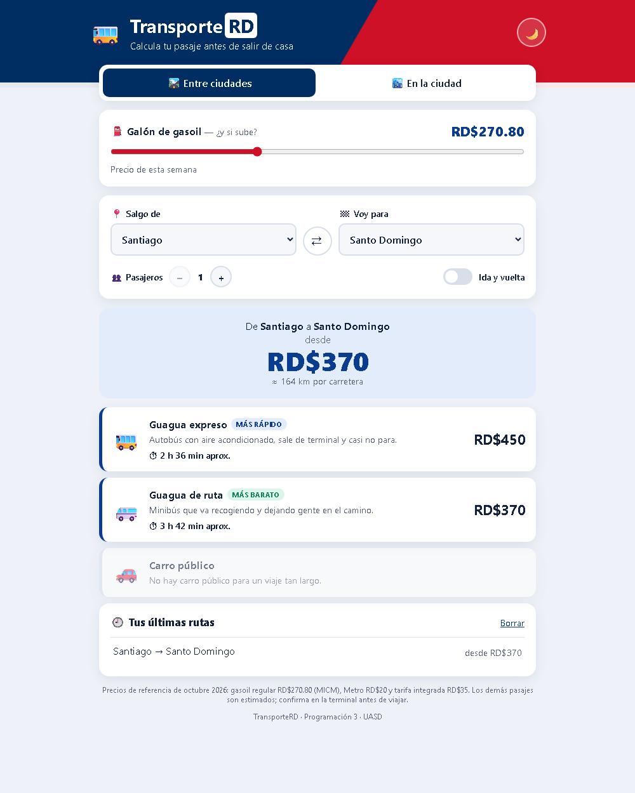
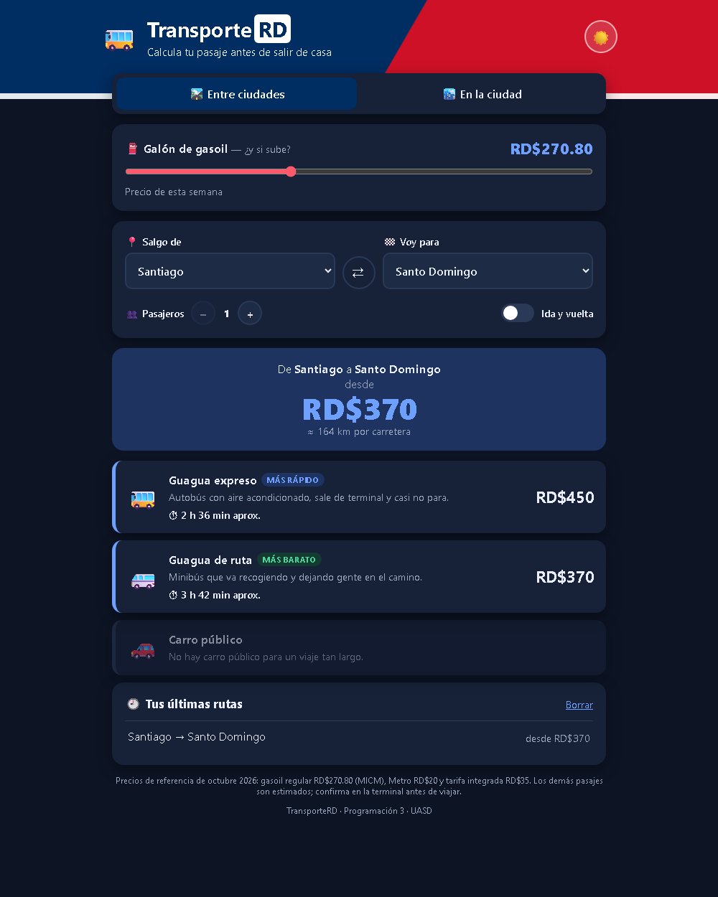
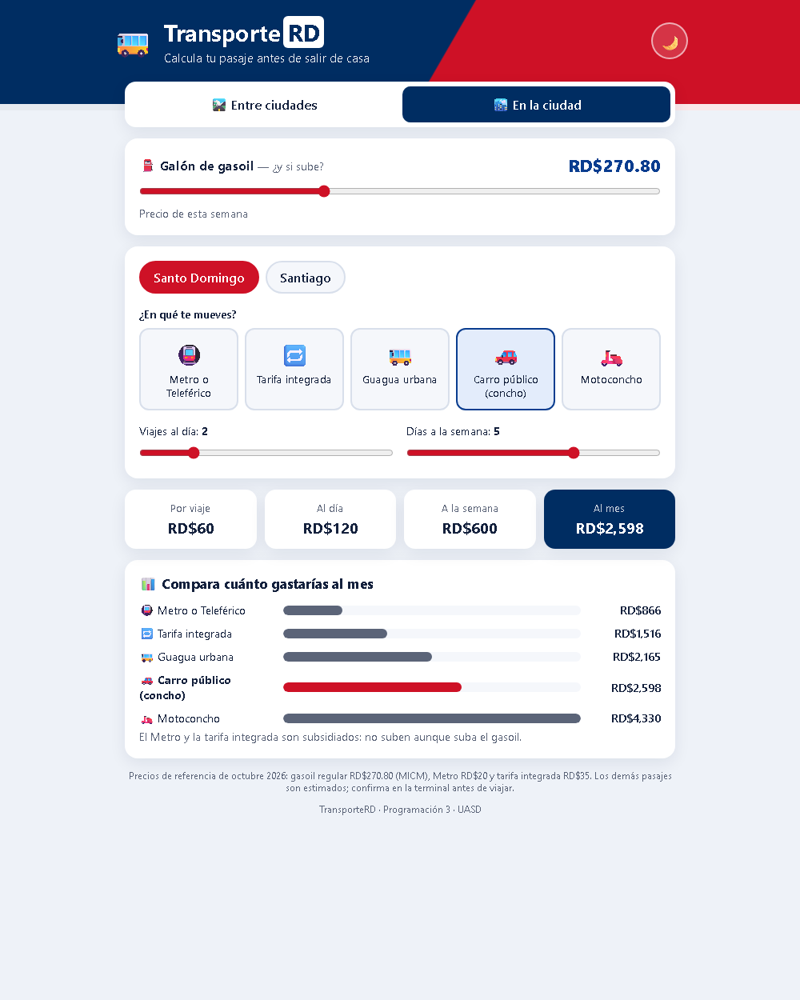

# 🚌 TransporteRD — Calcula tu pasaje

**Reto 4 · Proyecto en grupo · Lenguaje de Programación III (INF5160-18) — UASD**
**Profesor:** Edian Franklin Franco De los Santos

**Grupo:** Grupo 4

**Integrantes:**

- Benson Ho Chen
- Abel Taveras
- Joanfi Espinal López
- Yadeiry Nicole Brito Reynoso
- José Peña



## Descripción del proyecto

Tras las alzas del combustible, muchos dominicanos necesitan saber cuánto les va a costar moverse antes de salir de casa. **TransporteRD** es una herramienta ligera que calcula el costo estimado de los pasajes en República Dominicana.

Tiene dos partes:

**🛣️ Entre ciudades.** Eliges de dónde sales y para dónde vas (28 ciudades del país) y la app te dice cuánto cuesta el viaje en:

- **Guagua expreso**: autobús con aire que sale de terminal.
- **Guagua de ruta**: minibús que va parando en el camino.
- **Carro público**: solo entre pueblos cercanos (menos de 70 km).

Muestra el precio, el tiempo aproximado y la distancia, y marca cuál es el **más barato** y el **más rápido**. Se puede calcular para varios pasajeros y para ida y vuelta. Ejemplo: **de Santiago a Santo Domingo, RD$450 en guagua expreso**.

**🏙️ En la ciudad.** Para el día a día en Santo Domingo o Santiago: eliges en qué te mueves (Metro, Teleférico, tarifa integrada, guagua, concho o motoconcho), cuántos viajes haces al día y cuántos días a la semana, y te dice **cuánto gastas al día, a la semana y al mes**, con una gráfica para comparar.

**⛽ ¿Y si sube el gasoil?** Una barra permite cambiar el precio del galón de gasoil y todos los pasajes se recalculan al momento, para ver cómo nos afecta una subida. El Metro y la tarifa integrada no cambian porque son subsidiados.

**Otras funciones:**

- Historial de las últimas 5 rutas consultadas (se guarda en el navegador).
- Modo oscuro y modo claro (recuerda el que elegiste).
- Animaciones al mostrar resultados, al intercambiar origen y destino, y en las gráficas.
- Diseño adaptado a celular.




### ¿Cómo se calcula el pasaje?

1. **Distancia:** cada ciudad tiene su latitud y longitud. Con la fórmula de Haversine se calcula la distancia en línea recta y se multiplica por 1.22, porque las carreteras dan vueltas.
2. **Precio:** `precio = base + precio_por_km × kilómetros`. Cada transporte tiene su base y su precio por km. Se ajustó para que Santiago → Santo Domingo en guagua expreso dé RD$450.
3. **Combustible:** el 40% del pasaje depende del gasoil. Si el gasoil sube un 10%, el pasaje sube un 4%.
4. El resultado se redondea a 10 pesos, como cobran las guaguas.

**Precios de referencia (octubre 2026):** gasoil regular RD$270.80 por galón (MICM, semana del 24 al 30 de octubre), Metro y Teleférico RD$20 y tarifa integrada RD$35. Los demás pasajes son **estimados**.

## Tecnologías usadas

- **React 19** (componentes, props, `useState`, `useEffect` y un hook propio `usePersistente`)
- **JavaScript** (ES modules)
- **HTML5**
- **CSS3** puro (variables CSS para el modo oscuro, Grid, Flexbox, animaciones con `@keyframes`)
- **Vite** para el entorno de desarrollo
- **Git** y **GitHub** para el control de versiones
- **GitHub Actions** ya configurado para publicar la app en **GitHub Pages**

## Cómo ejecutarlo

**Sin instalar nada:** abre `abrir.html` con doble clic.

> El `index.html` de la raíz no se abre con doble clic (sale en blanco): es el archivo que usa Vite y solo funciona con `npm run dev`.

**Como programador** (necesitas Node.js):

```bash
npm install
npm run dev
```

## Cómo está organizado

```
src/
├── main.jsx                        → arranca React
├── App.jsx                         → pestañas, modo oscuro y precio del gasoil
├── index.css                       → todos los estilos y animaciones
├── components/
│   ├── Encabezado.jsx              → título y botón de modo oscuro
│   ├── PanelCombustible.jsx        → barra "¿y si sube el gasoil?"
│   ├── CalculadoraInterurbana.jsx  → viajes entre ciudades
│   ├── TarjetaTransporte.jsx       → el resultado de cada transporte
│   ├── Historial.jsx               → últimas rutas consultadas
│   └── CalculadoraUrbana.jsx       → gasto diario, semanal y mensual en la ciudad
├── data/
│   ├── ciudades.js                 → 28 ciudades con su ubicación
│   └── tarifas.js                  → precios de cada transporte
└── logic/
    ├── calculos.js                 → distancia, pasajes y formato de pesos
    ├── storage.js                  → guardar y leer en localStorage
    └── usePersistente.js           → hook: useState que se guarda en el navegador
```

## Qué aprendimos

- A dividir una aplicación en **componentes** pequeños y pasarles datos con **props**. Por ejemplo, el precio del gasoil vive en `App` y baja a las dos calculadoras, y por eso cuando lo cambias se actualiza todo a la vez.
- Que no hace falta guardar en el estado lo que se puede **calcular**: los precios se calculan cada vez a partir del origen, el destino y el gasoil.
- A usar `useEffect` para guardar en `localStorage` y para aplicar el modo oscuro en la página.
- A crear nuestro propio **hook** (`usePersistente`) para no repetir el mismo código de guardar y leer.
- A hacer un **modo oscuro** con variables de CSS: solo se cambian los colores y todo el diseño se adapta.
- A usar **animaciones CSS** (`@keyframes`) y a respetar a quien tiene desactivadas las animaciones en su sistema.
- A trabajar con **Git** y a dejar la app lista para publicarla en internet con **GitHub Pages**.
- Que para que una calculadora sea útil hay que buscar **datos reales**: el precio del gasoil, la tarifa del Metro y un precio conocido para comparar (Santiago → Santo Domingo).

## Enlace de despliegue

_Pendiente: lo agrega el integrante que publique la app._

El proyecto ya trae todo para publicarlo gratis en GitHub Pages:

1. Crear un repositorio público en GitHub y subir este proyecto a la rama `main`.
2. En el repositorio ir a **Settings → Pages** y en **Source** elegir **GitHub Actions**.
3. Esperar 1 o 2 minutos: el archivo `.github/workflows/deploy.yml` compila y publica la app solo.
4. El enlace queda así: `https://USUARIO.github.io/NOMBRE-DEL-REPO/`. Ponerlo aquí y en `evidencia_historial.txt`.
